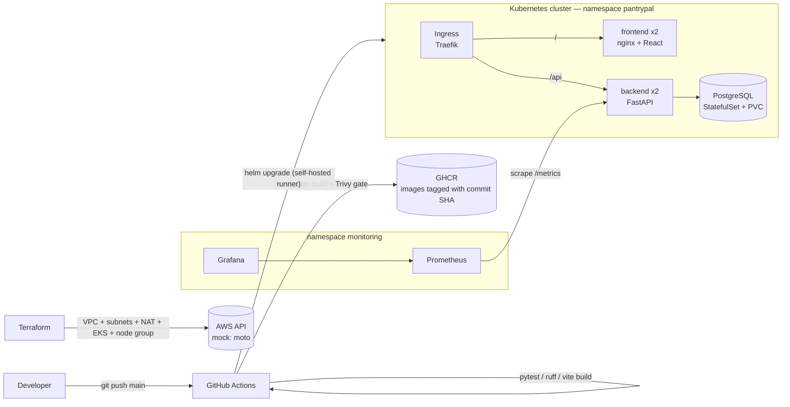

# PantryPal — DevOps Capstone

**PantryPal** is a home pantry inventory tracker. You record what's in your kitchen — name, category,
quantity and unit, and an optional expiry date. PantryPal then sorts everything by what expires first,
flags items expiring within 3 days or already expired, and shows summary stats so less food gets thrown away.


The application is a React frontend, a FastAPI backend and a PostgreSQL database. The rest of the repository is
the DevOps layer around it: tests, containers, CI/CD with a security gate, infrastructure as code,
Kubernetes/Helm deployment and observability.

## Architecture



## Tech stack

| Layer | Technology |
|-------|------------|
| Frontend | React 19 + Vite, served by unprivileged Nginx |
| Backend | FastAPI, SQLAlchemy 2, Pydantic 2, Alembic migrations |
| Database | PostgreSQL 16 |
| Tests / quality | pytest (17 tests, isolated SQLite DB), ruff |
| Containers | Multi-stage Dockerfiles, non-root users, Docker Compose |
| CI/CD | GitHub Actions → GHCR, images tagged with the Git commit SHA |
| Security | Trivy image scan, fails on fixable HIGH/CRITICAL CVEs |
| IaC | Terraform: VPC, 2 public and 2 private subnets, NAT, IAM, EKS + managed node group |
| Orchestration | Kubernetes (kind locally / EKS), Helm chart, Traefik Ingress |
| Observability | prometheus-fastapi-instrumentator, Prometheus, Grafana dashboard |

## Repository layout

```
backend/            FastAPI app, Alembic migrations, pytest suite, Dockerfile
frontend/           React app, nginx config template, multi-stage Dockerfile
docker-compose.yml  Local stack: frontend (:3000), backend (:8000), postgres
.github/workflows/  CI/CD pipeline (test → build → Trivy → push → deploy)
terraform/          AWS VPC + EKS (runs against local mock AWS by default)
k8s/                Namespaces, kind cluster config, Traefik values
helm/pantrypal/     Helm chart: Deployments, Services, StatefulSet, Ingress, PDBs
monitoring/         Prometheus + Grafana Helm values, Grafana dashboard JSON
scripts/            setup-local-cluster.sh, generate-traffic.sh
docs/               Screenshots, evidence, security-scan notes, demo script
```

## API

| Method | Path | Description |
|--------|------|-------------|
| GET | `/health`, `/api/health` | Liveness + deployed version (commit SHA) |
| GET | `/api/items?category=&search=` | List items, soonest expiry first |
| GET | `/api/items/{id}` | Get one item |
| POST | `/api/items` | Create an item |
| PUT | `/api/items/{id}` | Update an item (partial) |
| DELETE | `/api/items/{id}` | Delete an item |
| GET | `/api/items/stats` | Totals, expiring soon, expired, counts by category |
| GET | `/api/categories` | Allowed categories |
| GET | `/metrics` | Prometheus metrics |

Interactive docs: `http://localhost:8000/docs` when running with Compose.

## Quick start

### 1. Run with Docker Compose

```bash
cp .env.example .env          # optional — defaults work for local dev
docker compose up --build
```

Open <http://localhost:3000>. The API is also on <http://localhost:8000>. Migrations run automatically when the backend starts.

### 2. Run the tests

```bash
cd backend
python -m venv .venv && source .venv/bin/activate
pip install -r requirements-dev.txt
ruff check .
pytest -v
```

The tests use an in-memory SQLite database through a FastAPI dependency override (`tests/conftest.py`),
so they never touch PostgreSQL.

### 3. Kubernetes + Helm + monitoring (local kind cluster)

```bash
scripts/setup-local-cluster.sh            # kind, Traefik, app, Prometheus, Grafana
scripts/generate-traffic.sh http://pantrypal.localtest.me 300
```

| URL | What |
|-----|------|
| <http://pantrypal.localtest.me> | App, through the Ingress (`/` → frontend, `/api` → backend) |
| <http://prometheus.localtest.me/targets> | Prometheus targets (`pantrypal-backend` 2/2 UP) |
| <http://grafana.localtest.me> | Grafana → *PantryPal API* dashboard |

`*.localtest.me` always resolves to 127.0.0.1, so you don't need to edit `/etc/hosts`.

### 4. Terraform (mock AWS)

```bash
docker compose -f terraform/mock-aws/docker-compose.yml up -d
cd terraform && cp terraform.tfvars.example terraform.tfvars
terraform init && terraform plan -out tfplan && terraform apply tfplan
terraform destroy
```

See [terraform/README.md](terraform/README.md). The code also targets real AWS if you set `mock_aws_endpoint = ""`.

## CI/CD pipeline

[`.github/workflows/ci-cd.yml`](.github/workflows/ci-cd.yml) runs on every push and pull request to `main`:

1. **Backend lint + pytest.** Ruff and the test suite run. Any failing test fails the build.
2. **Frontend build.** `npm ci && npm run build`.
3. **Image (matrix: backend, frontend).** Runs only after both jobs above pass:
   - `docker build`, tagged `ghcr.io/<owner>/pantrypal-<component>:<commit-sha>` (never `latest`)
   - **Trivy** scan with `--severity HIGH,CRITICAL --exit-code 1`, so any fixable CVE fails the pipeline
   - push to **GHCR** (on pushes only, not pull requests)
4. **Deploy (optional).** `helm upgrade --install` with the new SHA tag on a self-hosted runner that has
   cluster access. It only runs when the repository variable `DEPLOY_ENABLED=true` is set. See [docs/demo.md](docs/demo.md).

## Security

- Both images run as non-root users: the backend as uid 10001, the frontend as uid 101 on nginx-unprivileged.
  The Kubernetes pods also set `runAsNonRoot`, drop all capabilities and block privilege escalation.
- No credentials are committed. `.env`, `terraform.tfvars` and state files are git-ignored. The database
  password is generated by Helm into a Secret, and the Grafana admin password lives in a Kubernetes Secret.
- The Trivy gate and its findings are described in [docs/security-scan.md](docs/security-scan.md).

## Evidence

All rubric screenshots are in [`docs/screenshots/`](docs/screenshots), indexed by module in
[docs/submission.md](docs/submission.md).

## Cleanup

```bash
docker compose down -v
kind delete cluster --name pantrypal
cd terraform && terraform destroy && docker compose -f mock-aws/docker-compose.yml down
```
